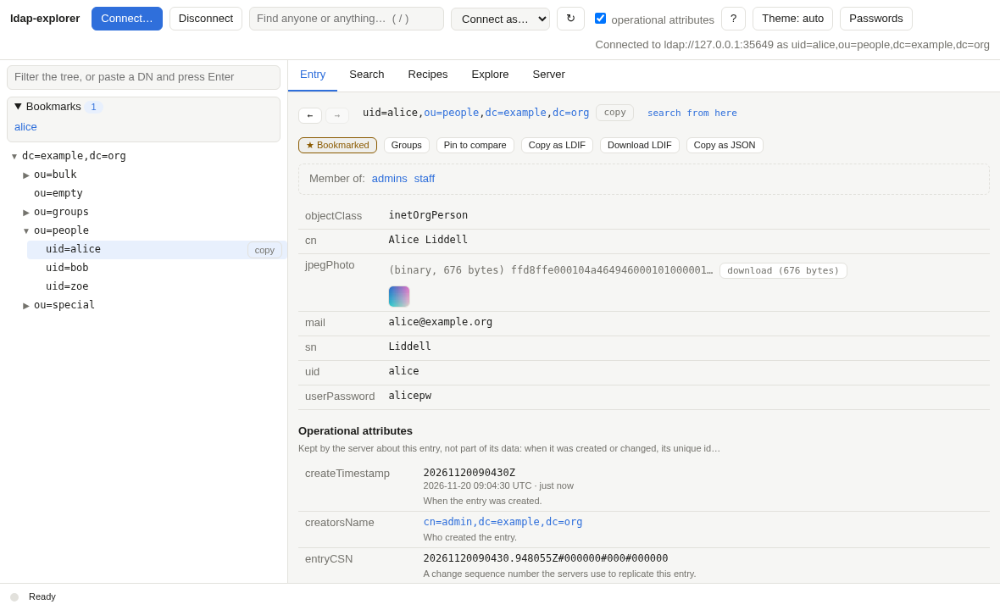

# ldap-explorer

A minimal, read-only LDAP browser for macOS and Windows. A single Go binary that serves the UI on `127.0.0.1` and opens your browser.



- **Search without knowing LDAP**: a search box in the top bar, a visual query builder (one-click field chips, suggestions and friendly names from the server's schema, operators and inputs that fit each field, a live filter preview with a plain-language explanation), ready-made recipes adapted to the server ("find a person", "members of a group", "locked accounts"...), and an explorer that shows what a branch contains
- **Read entries comfortably**: browsable tree with a quick filter, "go to DN", bookmarks, links between entries, breadcrumb; photos drawn in place, dates in plain words, the groups an entry belongs to; **compare two entries** field by field
- **Copy anything with one click**: attribute names, values, DNs, filters, table cells; **export** an entry or results as **LDIF**, **JSON** or **CSV**
- **Understand the server**: its type, features and a browsable **schema** (attributes, object classes, inheritance, matching rules) with "find entries that use this"
- Results as a list or a sortable table; saved queries and recent searches per profile; keyboard shortcuts; light, dark or system theme
- Passwords kept where you choose, per profile: nowhere, the system keychain (Keychain on macOS, Credential Manager on Windows, Secret Service on Linux) or an **encrypted vault** with a master passphrase (Argon2id + AES-256-GCM, locks itself when idle) for machines without a keychain. Several saved users and servers, with one-click "Connect as…" switching
- Read-only by design; `ldap://`, `ldaps://` and StartTLS; base DN auto-detected from the RootDSE; one self-contained binary, no cgo

See the [user manual](docs/USAGE.md) for how to use it and exactly what is and is not supported, and [working on the front end](docs/FRONTEND.md) if you want to change the interface.

## Build

Requires Go ≥ 1.27. No CGO needed.

```sh
make start        # builds it and runs it: opens the browser (flags: make start ARGS="-port 8080")
# or: make build, then ./ldap-explorer

make app          # LDAPExplorer.app (ad-hoc signed), drag it to /Applications
```

On Windows: `go build -o ldap-explorer.exe .`

When you build it on your own machine the binary has no quarantine attribute, so Gatekeeper does not complain.

## Options

```
-port 0            local port (0 = random)
-no-open           do not open the browser
-idle-exit 3m      exit if the tab has been closed for this long (0 = never)
```

## Security

- Listens only on `127.0.0.1`.
- Every start generates a random token that goes in the URL `#` fragment. The API requires it in a header, so other web pages open in the browser cannot use the server.
- Nothing is written to the LDAP server: it only does bind and search.

## Development: everything is a `make` target

`make help` lists them; CI runs the same ones, so what passes locally passes there.

```sh
make build         # ./ldap-explorer          make build-all   # all platforms into dist/
make app           # LDAPExplorer.app (macOS)
make lint          # gofmt, go vet, go mod tidy, JS syntax
make test          # Go + OpenLDAP integration, JS unit tests, browser tests
make ci            # lint + test + smoke: what every CI job runs
make test-docker   # make ci in a container with Go, OpenLDAP, Chromium and Node (reproducible)
make test-keychain # the REAL OS keychain (macOS / Windows)
make screenshots   # regenerate docs/img from the real UI
make front-dev     # serve the UI from front/ on disk: edit, refresh, no rebuild
```

## What the tests cover

The integration tests start an ephemeral `slapd` (OpenLDAP) loaded with `internal/slapdtest/seed.ldif`
plus 600 generated entries, on `ldap://` and `ldaps://` (self-signed certificate), and exercise the real API:
good/bad/anonymous bind, TLS and StartTLS, tree, entry view, searches, paging and server limits.
`slapd` is only a validation tool; what is under test is the app running on each OS. It is looked up in
`LDAP_EXPLORER_SLAPD_DIR`, in `PATH` and in common locations (apt, Homebrew…), or run inside WSL with
`LDAP_EXPLORER_SLAPD_WSL=<distro>` (Debian/Ubuntu layout). If no `slapd` is available the tests are skipped,
unless `LDAP_EXPLORER_REQUIRE_SLAPD=1` (CI sets it, so a missing server fails the run). To install it:
`apt install slapd ldap-utils` (Debian/Ubuntu) or `brew install openldap` (macOS; the OpenLDAP bundled with macOS has no mdb backend and is not used).

The JavaScript logic that needs no DOM (`front/js/table.js`: columns, sorting, CSV with spreadsheet-formula protection) has unit tests run by `node --test` (`hack/jstest.sh`; Node is only dev tooling, never shipped).

The browser tests (`e2e/`, a separate Go module so the app's `go.mod` stays free of the browser-automation dependency)
build the real binary, start it next to the same ephemeral OpenLDAP and drive its web UI in a headless Chrome
([chromedp](https://github.com/chromedp/chromedp)): connect, browse the tree, view entries, search, error messages and profiles.
Any JavaScript exception or console error fails the test. They need Chrome or Chromium installed; without it they are skipped,
unless `LDAP_EXPLORER_REQUIRE_CHROME=1`.

The real-keychain tests (Keychain / Credential Manager) only run with
`LDAP_EXPLORER_TEST_REAL_KEYRING=1 go test -run TestRealKeyring ./...`; they use temporary accounts under the `ldap-explorer` service and delete them afterwards.

### CI

`.github/workflows/ci.yml` runs on every PR and push to `main`, always through the Makefile targets, with a missing slapd, Chrome or Node being a failure and not a skip:
- **linux** (amd64 and arm64): `make test-docker`, that is `make ci` inside the test image (Go, OpenLDAP, Chromium, Node).
- **macos** (arm64): Homebrew OpenLDAP; `make ci`, `make test-keychain` (the real Keychain), and `make app` with `codesign --verify` and a smoke test of the `.app`.
- **windows** (amd64): Ubuntu's `slapd` in WSL1; `make ci` and `make test-keychain` (the real Credential Manager).
- **build-all**: `make build-all` compiles for macOS (arm64, amd64), Windows and Linux (amd64, arm64).

Docker is only an option on Linux: macOS runners have no Docker engine and Windows runners only run Windows containers.
