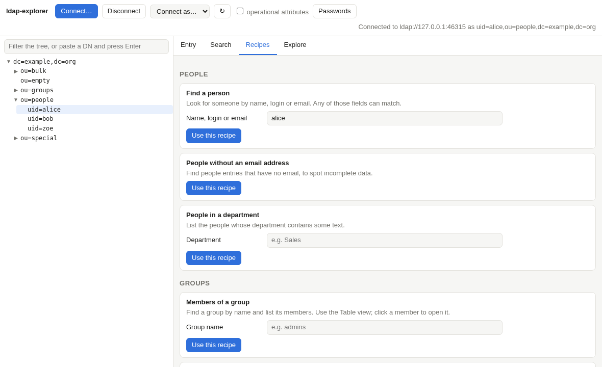
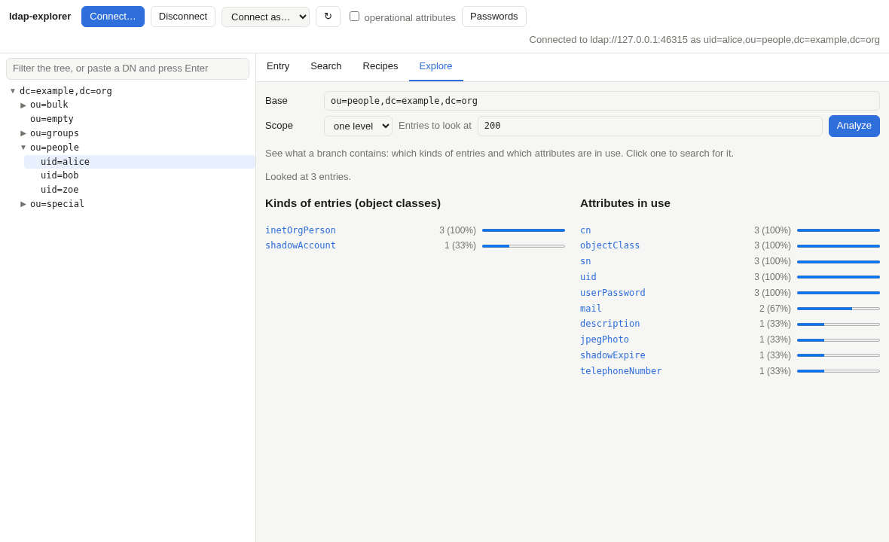
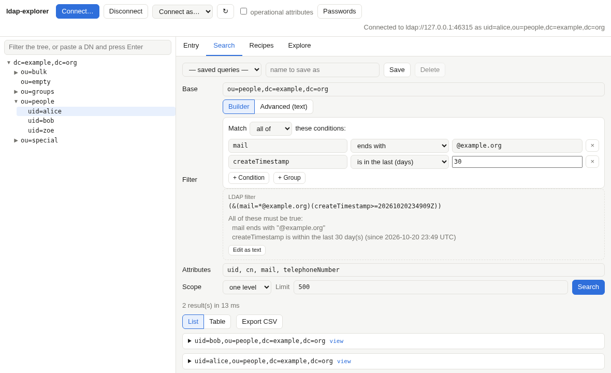

# ldap-explorer user manual

ldap-explorer is a read-only LDAP browser. It runs as a local program, serves its interface on `127.0.0.1` and opens it in your web browser. This manual explains how to use it and states plainly what it does and does not support.

## 1. Quick start

1. Build and start it (see the [README](../README.md#build)):
   ```sh
   make build && ./ldap-explorer        # macOS / Linux
   go build -o ldap-explorer.exe . && .\ldap-explorer.exe   # Windows
   ```
   Your browser opens on a local address such as `http://127.0.0.1:52341/#<token>`. If it does not, copy the URL printed in the terminal (start with `-no-open` to never open it automatically).
2. Click **Connect…**, fill in the server, and press **Connect**.
3. Browse the tree on the left; click an entry to see its attributes, or use the **Search** tab.
4. Close the browser tab when you are done: the program exits by itself a few minutes later (see `-idle-exit`). In a terminal you can also press Ctrl+C.

## 2. Connecting


| Field | Meaning |
|---|---|
| **Profile** | Pick a saved profile to fill the form, or `— new —`. The trash button deletes the selected profile. |
| **Name** | Name of the profile (required only to save it). |
| **URL** | `ldap://host[:port]` or `ldaps://host[:port]`. Default ports are 389 and 636. |
| **Bind DN** | The DN to authenticate as. For Active Directory a `user@domain` form also works. Empty means an anonymous connection. |
| **Password** | Required whenever a Bind DN is set (an empty password with a Bind DN is rejected by the client). |
| **Base DN** | Optional. Empty means it is detected from the server's RootDSE (`namingContexts`). If detection finds nothing, set it here. |
| **StartTLS** | Upgrade an `ldap://` connection to TLS. Ignored for `ldaps://`. |
| **Skip certificate verification** | Accept any server certificate. Insecure; use it only for lab servers with self-signed certificates. |
| **Password kept** | Where the password is saved: nowhere, the system keychain or the encrypted vault. See section 5. |

**Save profile** stores the form (without the password) so you can reuse it. **Disconnect** closes the connection; **↻** reloads the tree.

There is one connection at a time. Connecting again replaces the previous one.

## 3. Browsing


- The tree starts at the detected (or configured) base DN(s). Click ▶ or double-click a node to expand it; click a node to see its entry.
- Servers that report whether an entry has children (OpenLDAP does, through `hasSubordinates`) get a ▶ only on nodes that have some. Servers that do not report it (Active Directory never does) make every node show ▶; expanding an empty node simply removes the arrow.
- Children are read in pages of 500, so servers that cap results per request still list everything the server allows. If the server's size limit cuts a listing, a `⚠` line appears at the end of that node with the server's message; what was received is still shown.
- The entry view lists attributes alphabetically with `objectClass` first. Multi-valued attributes show one value per line. **copy** copies the DN; **search from here** jumps to the Search tab with that DN as the base.
- Tick **operational attributes** to also show the server's operational attributes, such as `entryUUID` or `createTimestamp` on OpenLDAP.
- Binary values (for example `jpegPhoto`, `objectGUID`, `objectSid`) are shown as `(binary, N bytes)` followed by the first 16 bytes in hex. They cannot be downloaded, previewed or decoded.

### Moving around faster

- **Filter the tree**: type in the box above the tree. Only the nodes you have already opened are searched (use Search for the whole directory); the ancestors of a match stay visible. Escape clears it.
- **Go to a DN**: paste a DN in that same box and press Enter. It works in any letter case, and the tree opens the branches that lead to the entry.
- **Follow links**: attributes whose value is a DN (such as `member`, `manager` or `owner`; ldap-explorer knows them from the server's schema) are links to that entry.
- **Breadcrumb**: in the entry view, every ancestor in the DN is a link, so one click goes up a level.

## 4. Searching

Open the **Search** tab. You never need to write LDAP filter syntax: there are three ways to search, from most to least assisted.

| | |
|---|---|
| **Recipes** | Ready-made questions ("Find a person", "Members of a group"...). See section 4.3. |
| **Builder** | Build the condition with rows of *attribute · operator · value*. The default. See section 4.1. |
| **Advanced (text)** | Type an RFC 4515 filter yourself. |

The rest of the form is common:

| Field | Meaning |
|---|---|
| **Base** | Where to start. Pre-filled with the first base DN after connecting. |
| **Filter** | The builder, or the text filter in Advanced mode. |
| **Attributes** | Comma- or space-separated names to return, e.g. `cn, mail, memberOf`. Empty returns all user attributes. Use `*` for all user attributes and `+` for all operational attributes, e.g. `* +`. |
| **Scope** | `subtree`, `one level` or `base only`. |
| **Limit** | Maximum number of entries (default 500). A value that is zero, empty or above 10000 falls back to 500. |

Press **Search** or Enter in any field. Results are collapsible; click **view** to open an entry in the Entry tab. A single result opens automatically.

### 4.1 The query builder


- Each row is a condition: pick an **attribute** (the box suggests the attributes your server really has, user attributes first), an **operator** and a **value**.
- **The operators depend on the attribute.** Text offers *is*, *is not*, *contains*, *starts with*, *ends with*, *matches pattern (use \*)*, *exists* and *does not exist*. Dates offer *is after*, *is before* and *is in the last (days)* with a date picker (times are converted to UTC). Numbers offer *is at least* / *is at most*. Yes/no attributes offer a true/false choice. Binary attributes only offer *exists*. If the server has no rule to compare an attribute in some way (for example OpenLDAP's `shadowExpire` cannot be ordered), that operator is not offered, instead of returning misleading results.
- For `objectClass` the value box suggests the object classes of the server.
- **Match all of / any of / none of** decides how the rows combine. **+ Group** adds a nested group, for example *all of: mail contains example, and any of: (uid is alice, uid is bob)*.
- Below the rows you always see the **LDAP filter** that will be sent and a **plain-language explanation** of it, updated as you type. Special characters in values (`( ) * \`) are escaped for you, so what you type is always taken literally (use the *pattern* operator if you want `*` as a wildcard).
- Mistakes are explained before you search, for example an attribute that does not exist on the server.
- **Edit as text** copies the filter to the Advanced mode so you can refine it by hand.

### 4.2 Saved queries

Above the form, **Save** stores the current search under a name for the current connection profile: base, scope, attributes, limit and either the builder conditions or the text filter. Choosing it from the list puts everything back in the form (it does not run it; press Search). **Delete** removes it. They are kept in `queries.json` next to `profiles.json` and never contain credentials. A connection that is not a saved profile keeps its queries under its URL.

### 4.3 Recipes



The **Recipes** tab offers ready-made questions in four groups: *People* (find a person by name, login or email; people without an email; people in a department), *Groups* (members of a group; groups a user belongs to), *Accounts* (locked or disabled; expired; created or changed in the last N days) and *Explore* (entries of an object class; entries that have, or lack, an attribute).

- Fill in the few parameters and press **Use this recipe**: it opens in the builder, so you can see and tweak how it works, and runs immediately.
- Recipes are **built from your server's schema**: a recipe only uses attributes the server defines (for example *Find a person* matches `uid` on OpenLDAP and `sAMAccountName` on Active Directory). One the server cannot answer is shown greyed out with the reason, such as *Locked or disabled accounts* on a server without `nsAccountLock` or `pwdAccountLockedTime`.

### 4.4 Exploring a branch



Not sure what is in a branch? **Explore** looks at up to a number of entries below a base (the selected tree node by default) and shows which **kinds of entries** (object classes) and which **attributes** are really in use, with counts. Click any of them to search for those entries.

### 4.5 Results: list, table and CSV



Above the results there are two views, **List** and **Table**, and an **Export CSV** button. The chosen view is remembered for the next search.

- **List**: one collapsible block per entry with all its attributes.
- **Table**: one row per entry. The columns are the attributes you asked for, in your order; if you left the field empty (or used `*` / `+`), they are the attributes found in the results, most frequent first. Click a header to sort (natural order, so `u2` comes before `u10`; empty cells always go last) and click again to reverse. **Columns** lets you hide the ones you do not need. Click a DN to open the entry. The table draws at most 1000 rows; the CSV always has all of them.
- **Export CSV** saves exactly what the table shows now (visible columns, current order) plus a `dn` column. The file is UTF-8 with a byte order mark, so Excel opens accents correctly. Multiple values of one attribute are joined with `; `. Cells that start with `=`, `@`, `+` or `-` are prefixed with an apostrophe so spreadsheets do not run them as formulas (a directory is untrusted input); phone numbers such as `+34 600 000 001` are left as they are.


The interface follows the system light or dark setting:


Results are paged internally (up to 500 per request). If the server (or the limit you set) stops the search early, you get the entries received plus a `⚠` warning, such as `Size Limit Exceeded`, instead of an error.

## 5. Passwords, the vault and several users


### Where a password can be kept

Each profile chooses, in **Password kept**:

| Choice | What it does |
|---|---|
| **Do not save** | The password is never stored. You type it each time. The safest, the least convenient. |
| **System keychain** | macOS Keychain, Windows Credential Manager or the Linux Secret Service. Protected by your operating system login. Not offered (and explained) on machines that have none, such as many Linux, WSL or headless setups. |
| **Encrypted vault** | A file protected by a **master passphrase** you choose, for machines without a keychain or if you prefer not to depend on it. |

Passwords are **never** written to `profiles.json` and the interface never receives one back: it only says whether one is saved. Leave the password field empty to use the saved one.

### The vault

- The first time you save a password in it you are asked to create it (a passphrase of at least 8 characters). **There is no way to recover the passwords if you forget it**: delete the vault and enter them again.
- It starts **locked** and is unlocked by typing the passphrase when something needs it. It **locks itself after 15 minutes without use**; **Passwords → Lock now** locks it at once. The keys are wiped from memory when it locks.
- The file (`vault.json`) is encrypted with AES-256-GCM using a key derived from the passphrase with Argon2id (64 MiB, 3 passes). It does not even reveal *which* users or servers it holds, only how many entries there are. Tampering with the file is detected.
- Wrong passphrases are slowed down: after three failures each attempt has to wait longer (2 s, 4 s... up to a minute).
- **Passwords → Change the passphrase** re-encrypts everything under a new one.

### Several users, several servers

Each profile is one *user on one server*, with its own saved password, so you can keep as many as you need:

- **Connect as…** (top bar) lists your profiles as *name — user @ server*. Choosing one connects at once with its saved password, switching from whichever one you were using. If that profile keeps no password, the connection dialog opens ready for you to type it.
- **Add another user** (in the connection dialog) copies the server settings of the profile you are editing so you only enter the other user's name, DN and password. Use it for several accounts on one LDAP, for example your own and an administrator.
- The same user DN on two different servers (or on the same server over two URLs) are two different profiles with two different passwords.
- **Passwords** (top bar) shows, for every profile, where its password is kept and whether it is there (*saved*, *vault locked*, *not saved*...). **Forget password** removes it and stops saving it for that profile. Entries in the vault that no profile uses any more (for example after deleting a profile while the vault was locked) are listed so you can remove them.

When you change **where** a password is kept, it is **moved** (you do not retype it) and the old copy is removed. Changing the user of a profile, or deleting the profile, also removes the old password.

### Where things are stored

In your user configuration folder:

| | |
|---|---|
| macOS | `~/Library/Application Support/ldap-explorer/` |
| Windows | `%AppData%\ldap-explorer\` |
| Linux | `~/.config/ldap-explorer/` |

with `profiles.json` (server settings and which store each profile uses, never a password), `queries.json` (saved queries), and `vault.json` (the encrypted vault), all private to your user. The keychain keeps its entries under the service name `ldap-explorer`, account `<bind DN>@<URL>`.

### What this does not protect against

Be clear about the limits:

- Someone who can run programs as **your user** while the vault is unlocked, or while you are logged in for the keychain, can read what you can read. The vault protects the file at rest (a copy of it, a backup, a lost laptop), not a compromised session.
- The strength of the vault is the strength of your passphrase: a long one is far better than a short one if someone gets a copy of `vault.json`.
- The passphrase and the passwords pass through the memory of the program, and a managed runtime cannot guarantee wiping them: they may stay there until the memory is reused. The vault's keys are wiped on lock; strings are not.
- A saved password is used as it is to bind: ldap-explorer cannot make an LDAP server more secure than the connection to it, so prefer `ldaps://` or StartTLS and avoid *Skip certificate verification*.
- Entries saved by earlier versions in the macOS Keychain keep working, with one exception: a password containing non-ASCII characters saved by the old version could not be read back correctly then either. Save the profile password again to fix it.

## 6. Command-line options

```
-port 0            local port (0 = random)
-no-open           do not open the browser automatically
-idle-exit 3m      exit if the UI sends no heartbeat for this long (0 = never)
```

The 3-minute default is deliberate: browsers throttle timers in background tabs, so a shorter value could make the program quit while the tab is still open.

## 7. Security model

- It listens only on `127.0.0.1`.
- Every start creates a random token placed in the URL `#` fragment (browsers never send fragments to servers). The API rejects requests without it, so other web pages cannot use the local server.
- It never modifies the directory: only bind and search operations are issued.
- Nothing is loaded from the internet by the interface (a strict Content-Security-Policy blocks it), and nothing is downloaded at run time.

## 8. What is supported

| Area | Status |
|---|---|
| Plain, `ldaps://` and StartTLS connections | Supported and tested (OpenLDAP). |
| Simple bind with DN + password; anonymous access | Supported. |
| Base DN auto-detection from the RootDSE | Supported. |
| Tree browsing with paging | Supported. |
| Entry view, operational attributes, binary summary, UTF-8 values | Supported. |
| Searches: visual builder with live filter and explanation, text filter, scopes, attribute list, limit, paging, server size limits | Supported. |
| Recipes and branch explorer | Supported. Recipes adapt to the server's schema; tested against OpenLDAP. |
| Saved queries per profile | Supported. |
| Tree filter, go to DN, DN links, breadcrumb | Supported. |
| Results as a sortable table with CSV export | Supported. |
| Saved profiles (no password) | Supported. |
| Passwords in the system keychain | macOS Keychain and Windows Credential Manager: supported and tested in CI. Linux (Secret Service): the library supports it but ldap-explorer is not tested against it. |
| Passwords in an encrypted vault with a master passphrase | Supported on every platform, tested. |
| Several saved users and servers, with one-click switching | Supported. |
| Dark and light theme (follows the system) | Supported. |

### Platforms

| Platform | Status |
|---|---|
| macOS arm64 | Supported. Built locally; the test suite, the Keychain tests and the `.app` build run in CI. |
| macOS amd64 | Cross-compiled in CI only; never run. |
| Windows amd64 | Supported. The test suite and the Credential Manager tests run in CI. No icon, and a console window stays open while it runs. |
| Linux | Builds and passes the test suite in CI; used mainly for development. Keychain not tested. |

### Servers

Tested against OpenLDAP 2.5, 2.6 and 2.7 only. The account recipes for 389 Directory Server (`nsAccountLock`, `passwordExpirationTime`) and for the OpenLDAP ppolicy overlay are checked against synthetic schemas, not against those real servers. Microsoft Active Directory and other servers should work for browsing and searching (the protocol operations are standard) but have **not** been tested. Known AD difference: no children hints, so every node shows ▶.

## 9. What is not supported

- **Any write operation**: add, modify, delete, rename, password change. This is intentional and checked by a test.
- **SASL, GSSAPI/Kerberos, NTLM and other bind mechanisms** (including single sign-on with your Windows or macOS login). Only simple bind is available.
- **Client certificates** (mutual TLS) and **custom CA bundles**: server certificates are checked against the system trust store, or not at all with *Skip certificate verification*.
- **Referrals** are not followed.
- **Several connections or sessions at once**; a second browser tab shares the same connection.
- **LDIF or JSON export**, importing, and search history. (CSV export and saved queries are supported.)
- **Schema browsing**, ACL inspection, and decoding of binary attributes (no image preview, no GUID/SID formatting).
- **Server-side sorting, virtual list view and other LDAP controls.**
- **Proxy settings**: connections are direct.
- **Viewing a stored password**: by design there is no way to read one back; you can replace it (save the profile with a new password), move it or forget it.
- **Recovering a forgotten vault passphrase**, and **a configurable auto-lock time** (it is 15 minutes).
- **Client certificates, SASL or Kerberos** as saved credentials: only a bind DN and password can be stored.
- **Windows `.exe` packaging** (icon, no console window) and a signed or notarized macOS build. The macOS `.app` is ad-hoc signed and meant to be built on the machine that runs it.

## 10. Troubleshooting

| Symptom | Likely cause |
|---|---|
| `bind: LDAP Result Code 49 "Invalid Credentials"` | Wrong DN or password. On AD try `user@domain`. |
| `ldap: empty password not allowed by the client` | A Bind DN is set but the password is empty. Enter it, use the keychain option, or clear the Bind DN for an anonymous connection. |
| `no password in the keychain for this profile` / `...in the vault...` | The profile says its password is kept there but nothing is stored for that DN and URL. Type the password and save the profile again. |
| `the vault is locked` | Type the master passphrase when asked (or **Passwords → Unlock**). It locks itself after 15 minutes without use. |
| `wrong passphrase` / `too many failed attempts` | After three failures each try waits longer, up to a minute. |
| `the system keychain is not available here` | There is no usable keychain (no Secret Service on Linux, WSL, a headless session). Use the encrypted vault, or do not save the password. |
| `keychain: …` | The operating system keychain is unavailable (for example no Secret Service on Linux). |
| Certificate error on `ldaps://` or StartTLS | The server certificate is not trusted by the system. Install its CA in the system store, or (insecure) tick *Skip certificate verification*. |
| `No base was detected` | The server does not publish naming contexts to this user. Set **Base DN** in the connection. |
| `⚠ … Size Limit Exceeded` | The server stopped the listing or search at its own limit. Narrow the filter or base. |
| `Invalid filter` | The filter is not valid RFC 4515 syntax (check the parentheses). |
| `The ldap-explorer process is not responding` | The program exited (idle timeout or Ctrl+C). Start it again. |
