# ldap-explorer user manual

ldap-explorer lets you look things up in an LDAP directory (the company's people, groups, computers...) **without knowing LDAP**. You search by filling in simple boxes, it explains what it is doing in plain words, and it never changes anything: it is read-only.

This manual goes from the simplest to the most advanced. If you only read one section, read section 1.

## Contents

1. [Quick start](#1-quick-start)
2. [The screen at a glance](#2-the-screen-at-a-glance)
3. [Connecting](#3-connecting)
4. [Finding things](#4-finding-things)
5. [Reading an entry](#5-reading-an-entry)
6. [Moving around](#6-moving-around)
7. [The server and its schema](#7-the-server-and-its-schema)
8. [Passwords, the vault and several users](#8-passwords-the-vault-and-several-users)
9. [Settings, command line and files](#9-settings-command-line-and-files)
10. [Security model](#10-security-model)
11. [What is supported](#11-what-is-supported)
12. [What is not supported](#12-what-is-not-supported)
13. [Troubleshooting](#13-troubleshooting)
14. [Glossary](#14-glossary)

## 1. Quick start

1. Start the program (see the [README](../README.md#build)). Your browser opens on a page that only your computer can see. If it does not, copy the address printed in the terminal.
2. Click **Connect…**, type the server address (for example `ldaps://ldap.example.com`), your user and your password, and press **Connect**.
3. Type a name, login or email in the box at the top (**Find anyone or anything**) and press Enter. The matching entries appear.
4. Click an entry to see everything it contains.

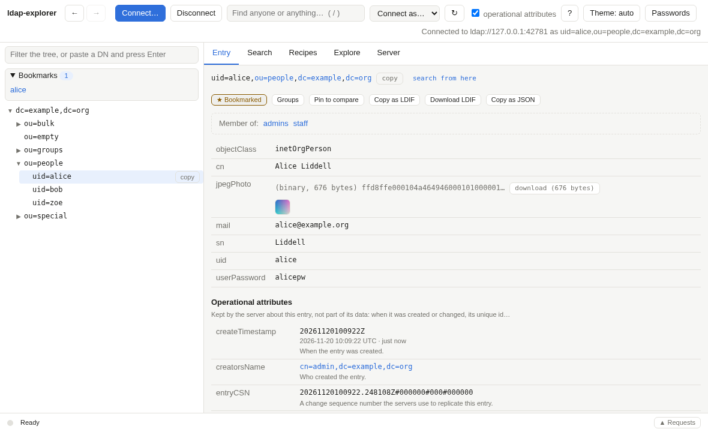

When you are done, close the tab: the program exits by itself a few minutes later.

## 2. The screen at a glance

- **Top bar**: **←** / **→** (Back and Forward through the places you have been); **Connect…** / **Disconnect**; the **search box** (press `/` to jump to it); **Connect as…** (switch between your saved users and servers in one click); **operational attributes** (also show the attributes the server keeps for itself, in their own section); **?** (keyboard shortcuts); **Theme** (light, dark or follow the system); **Passwords**; and the connection status on the right.
- **Left**: a box to **filter the tree or jump to a DN**, your **Bookmarks**, and the **tree** of the directory.
- **Right**, in tabs: **Entry** (what is selected), **Search** (build a search), **Recipes** (ready-made questions), **Explore** (what is in a branch) and **Server** (what this server is and what it can store).

- **Status bar** (bottom): what the program is doing right now. See [The status bar](#the-status-bar-is-it-working-or-is-it-stuck) below.

Almost everything that shows a value has a quiet **copy** button next to it that appears when you point at it. Pressing it copies exactly that thing and a small message confirms it.

### The status bar: is it working, or is it stuck?

Big directories take time. The bar at the bottom of the window tells you what is running, so you never have to wonder whether the program died.

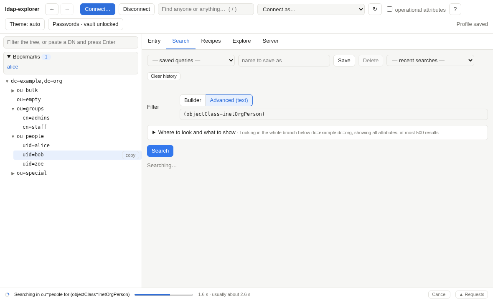

- **Nothing running**: it says *Ready*, with a grey dot.
- **Something is running** (a search, opening a branch of the tree, an export, loading the schema...): it says **what** (*Searching in ou=people for (objectClass=inetOrgPerson)*), **for how long** (*1.6 s*), **how many entries have arrived so far** on a big search (*1,500 entries so far*) and, when it has done the same thing before in this session, **how long it usually takes** (*usually about 2.6 s*). A moving circle shows it is alive; when it knows what to expect, a bar fills up (it never claims to be finished before the answer arrives). Anything quicker than about half a second never shows, so the bar does not flicker.
- **Taking a while**: after 10 seconds, or when it takes one and a half times longer than usual, the circle turns amber and the bar says *Taking longer than usual. Big directories can be slow; it is still working.*
- **Looks stuck**: if nothing at all has arrived from the server for 30 seconds, the circle turns red and it says *No answer from the server for 45 s. It may just be slow, not stopped; you can wait or cancel.* On a big search, every page of results counts as a sign of life, so a search that keeps delivering is never reported as stuck.
- **Cancel** stops waiting for what is running. The program stops asking the directory for more results as soon as it notices, and the result area says *Cancelled*. Nothing is changed anywhere: it is only a search that you no longer want.
- **When it ends**, the bar tells you for a few seconds how it went: *Done in 1.8 s · 600 entries*, *Cancelled after 3.0 s* or *Failed after 1.0 s*.
- **All the requests, in a list.** Several things can run at the same time (for example two searches, or opening a branch while a search is still going), and the bar only describes the oldest one, with *(2 running)* next to the button. **Click the bar** (or its **▲ Requests** button) to open the list above it, and click again to close it.

  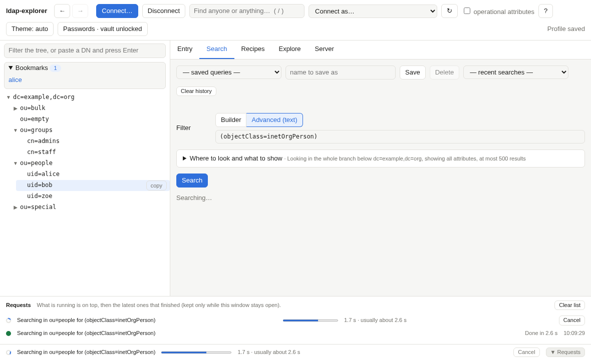

  - **Running now** are on top, oldest first. Each row shows what it is, how long it has been running, entries so far, how long it usually takes, its own progress bar and its own **Cancel** button (the Cancel in the bar cancels all of them).
  - Below are **the latest 20 that finished**, newest first: what it was, how it went (*Done in 1.8 s · 600 entries*, *Cancelled after 3.0 s*, *Failed after 1.0 s*) and **the time it started**. Requests quicker than half a second are not listed, failed ones always are.
  - **Clear list** empties the finished ones. The list lives only while the window stays open: nothing is saved and it never contains the results, only the descriptions you see.
- **Lost contact**: if the program itself stops answering (not the directory: ldap-explorer), the bar turns red and says so. Close the tab and start it again.

The estimate comes only from what this session has already done (the same search again, or the average of similar ones), and it is not saved anywhere. The first time you do something there is nothing to compare with, so only the time is shown.

## 3. Connecting


| Field | Meaning |
|---|---|
| **Profile** | Pick a saved profile to fill the form, or `— new —`. The trash button deletes the selected profile. |
| **Name** | Name of the profile (needed only to save it). |
| **URL** | `ldap://host[:port]` or `ldaps://host[:port]`. Default ports are 389 and 636. Prefer `ldaps://`. |
| **Bind DN** | The DN you sign in as. For Active Directory a `user@domain` form also works. Empty means an anonymous connection. |
| **Password** | Required whenever a Bind DN is set. |
| **Base DN** | Optional. Empty means it is detected from the server. Set it if the tree comes up empty. |
| **StartTLS** | Upgrade an `ldap://` connection to TLS. Ignored for `ldaps://`. |
| **Skip certificate verification** | Accept any server certificate. Insecure; only for lab servers with self-signed certificates. |
| **Password kept** | Where the password is saved: nowhere, your system keychain or the encrypted vault ([section 8](#8-passwords-the-vault-and-several-users)). |

**Save profile** stores the form so you can reuse it. **Add another user** keeps the server settings and lets you enter a second account on the same server. Once you have several profiles, **Connect as…** in the top bar switches between them in one click. There is one connection at a time.

## 4. Finding things

There are several ways to search, from the simplest to the most flexible. All of them end in the same results list.

| | |
|---|---|
| **Search box** (top bar) | Type a name, login or email and press Enter. Section 4.1. |
| **Recipes** | Ready-made questions: "Find a person", "Members of a group", "Accounts created recently"... Section 4.3. |
| **Builder** | Build the condition with rows of *field · operator · value*. Section 4.2. |
| **Explore** | See what a branch contains and click to search for it. Section 4.4. |
| **Advanced (text)** | Type an LDAP filter yourself. Section 4.5. |

### 4.1 The search box

The box at the top ("Find anyone or anything", shortcut `/`) looks in the names, logins and emails of every entry (people, groups, units) at once. The query it ran is shown in the builder, so you can refine it. It uses the "Find any entry" recipe.

### 4.2 The builder

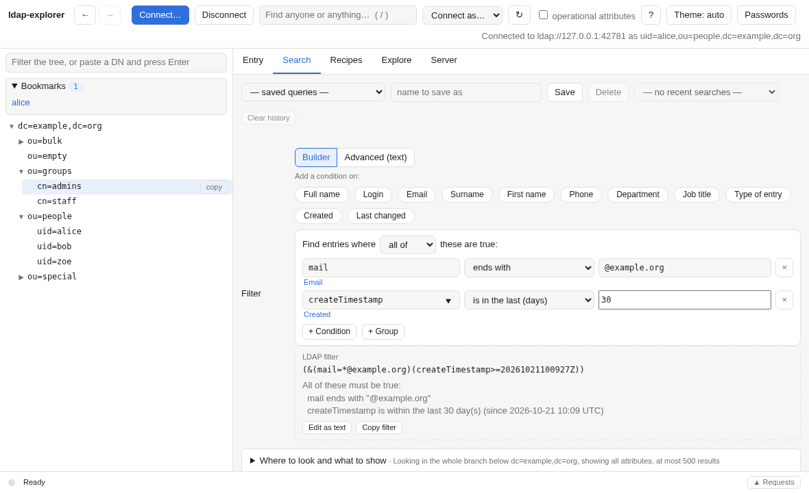

You never need to write filter syntax.

- Under **Add a condition on** there is a button for each common field this server has (Full name, Login, Email, Surname, Phone, Department, Type of entry, Created...). Click one to add a ready-to-fill condition.
- Each row is *field · operator · value*. The field box suggests the fields your server really has, with friendly names (Email for `mail`). The caption under it says what the field is.
- **The operators depend on the field.** Text offers *is*, *is not*, *contains*, *starts with*, *ends with*, *matches pattern*, *exists* and *does not exist*. Dates offer *is after*, *is before* and *is in the last (days)* with a date picker (times are UTC). Numbers offer *is at least* / *is at most*. Yes/no fields offer a true/false choice. Binary fields only offer *exists*. If the server has no way to compare a field in some way (for example OpenLDAP's `shadowExpire` cannot be ordered) that operator is not offered, instead of giving misleading results.
- **Servers that do not publish how fields can be compared.** Active Directory (and some other servers) describe their fields without saying which comparisons they accept, although they accept them. For those fields the builder offers the usual options for the *kind* of field (text: *is*, *contains*, *starts with*...; numbers and dates: also before / after) and puts a small **ⓘ** after the operator. Point at it for the explanation. If a search with such an option finds nothing, the server may not support it for that field. In the Server tab those fields say the same under *Can be compared for*. Servers that do publish the rules (OpenLDAP, 389DS) are followed exactly: a field that only allows *is* shows only *is*.
- For *Type of entry* (`objectClass`) the value box suggests the kinds of entry of this server.
- **Find entries where all of / any of / none of these are true** decides how the rows combine. **+ Group** adds a nested group, for example *all of: Email contains example.org, and any of: (Login is alice, Login is bob)*.
- Below the rows you always see the **LDAP filter** that will be sent and a **plain-language explanation** of it, updated as you type. Special characters you type (`( ) * \`) are escaped for you, so what you type is taken literally (use *matches pattern* if you want `*` as a wildcard).
- Mistakes are explained before you search, for example a field that does not exist on this server.
- **Copy filter** copies the LDAP filter; **Edit as text** moves it to the Advanced mode.

### 4.3 Recipes


The **Recipes** tab offers ready-made questions in four groups: *People* (find a person; people without an email; people in a department), *Groups* (members of a group; groups a user belongs to), *Accounts* (locked or disabled; expired; created or changed in the last N days) and *Explore* (find any entry; entries of a kind; entries that have, or lack, a field).

- Fill in the few parameters and press **Use this recipe**: it opens in the builder, so you can see and tweak how it works, and runs at once.
- Recipes are **built from your server's schema**: they only use fields the server defines (for example *Find a person* matches `uid` on OpenLDAP and `sAMAccountName` on Active Directory). One the server cannot answer is shown greyed out with the reason.

### 4.4 Explore


Not sure what is in a branch? **Explore** looks at a number of entries below a base (the selected tree node by default) and shows which **kinds of entries** and which **fields** are really in use, with counts. Click any of them to search for those entries.

### 4.5 Advanced: a typed filter

Choose **Advanced (text)** next to the builder to type an LDAP filter, for example `(&(objectClass=person)(mail=*@example.org))`. An invalid filter is rejected before it is sent. The *Edit as text* button of the builder gets you here with the filter already written.

### 4.6 Where to look and what to show

Folded under the builder there is a line like *"Looking in the whole branch below dc=example,dc=org, showing all attributes, at most 500 results"*. Open it to change it:

| Field | Meaning |
|---|---|
| **Base** | Where to start. Pre-filled with the top of the directory. |
| **Attributes** | Fields to return, e.g. `cn, mail, memberOf`. Empty returns all. Use `*` for all ordinary fields and `+` for the operational ones (`* +`). |
| **Scope** | `subtree` (the base and everything below), `one level` (only its direct children) or `base only`. |
| **Limit** | Maximum number of entries (default 500). Zero, empty or above 10000 falls back to 500. |

### 4.7 Saved queries and recent searches

Above the form, **Save** stores the current search under a name for the current profile (base, scope, attributes, limit and the builder conditions or the typed filter). Choosing it from the list puts everything back in the form (press Search to run it); **Delete** removes it. The list next to it, **recent searches**, remembers the last 30 searches you ran on this connection, newest first; a repeated search moves to the top. Both live next to your profiles and never contain credentials.

### 4.8 The results: list, table and exports


Above the results there are two views, **List** and **Table**. The chosen view is remembered.

- **List**: one collapsible block per entry with all its fields.
- **Table**: one row per entry. The columns are the fields you asked for; if you left the field empty they are the fields found in the results, most frequent first. Click a header to sort (natural order, so `u2` comes before `u10`; empty cells go last) and again to reverse. **Columns** hides the ones you do not need. Click a DN to open the entry; **click any other cell to copy it**. The table draws at most 1000 rows; the exports contain all of them.

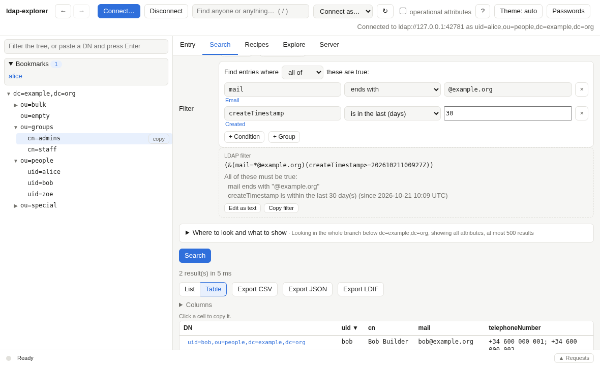

- **Export CSV** saves what the table shows now (visible columns, current order) plus a `dn` column, as UTF-8 with a byte order mark so Excel reads accents. Values of one field are joined with `; `. Cells starting with `=`, `@`, `+` or `-` get a leading apostrophe so spreadsheets do not run them as formulas (a directory is untrusted input); phone numbers like `+34 600 000 001` are left as they are.
- **Export JSON** saves the results as JSON (`dn` and `attributes`). Binary values appear as a summary.
- **Export LDIF** saves the results in LDIF, the standard format for moving directory data between tools, with the exact values (photos included). If the server cut the result short, you are told.

The interface follows the system light or dark setting, or your choice with the **Theme** button:

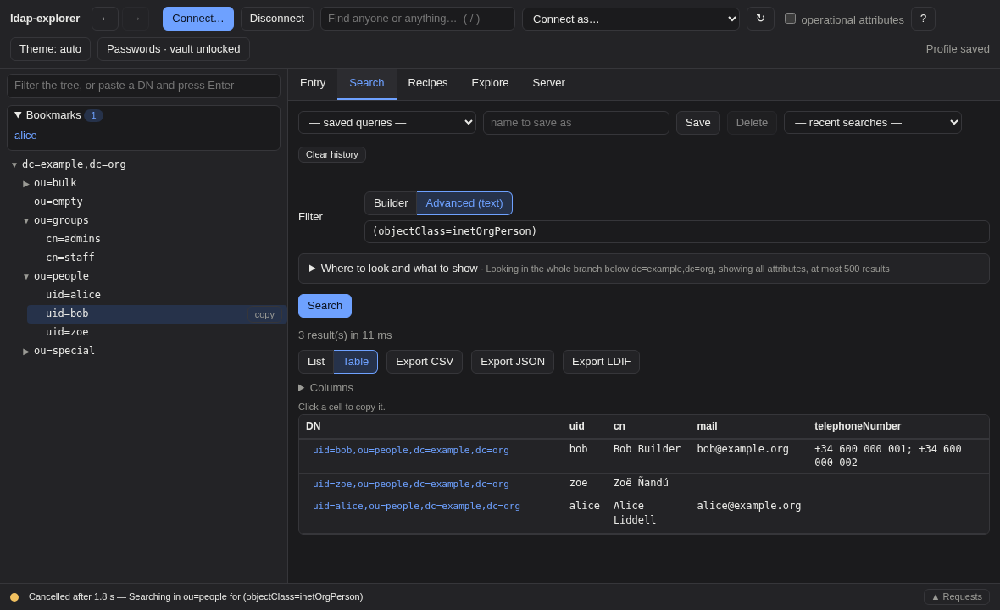

Searches are paged internally (up to 500 per request). If the server (or your limit) stops a search early, you get the entries received plus a `⚠` warning such as `Size Limit Exceeded`, not an error.

## 5. Reading an entry

Click an entry in the tree or in any result.

- **The DN** (the entry's full address) is a **breadcrumb**: click any part to go to that ancestor. **copy** copies it; **search from here** jumps to Search with it as the base.
- **Each attribute row** shows the name, its values and, when you point at the row, copy buttons: **name** copies the attribute name, **value** (or **first value**) copies the value, and **all N** copies every value, one per line.
- **Links**: attributes whose value is another entry (such as `member`, `manager`, `owner`, `seeAlso`) are links that open that entry; see [Following links](#following-links-back-and-forward) below.
- **Dates** (`createTimestamp` and the like) are shown as the server stores them, with a line in plain words below: *2026-11-19 12:00:00 UTC · 3 days ago*.
- **Binary values**: photos are drawn right there. Every binary value has a **download** button (with its size) and a **base64** copy button in the row.
- **Operational attributes** are what the server keeps for itself about the entry; see [Operational attributes](#operational-attributes) below.

Under the DN there are buttons:

| Button | What it does |
|---|---|
| **☆ Bookmark** | Keeps the entry in your **Bookmarks** (above the tree). Click again to remove it. |
| **Groups** | Lists the groups this entry is a member of, as links. It uses what the server's schema allows (`member`, `uniqueMember`, `memberUid`) and says so if the server cannot answer. |
| **Pin to compare** | Pins this entry. Open another entry and a **Compare with…** button appears. |
| **Copy as LDIF** / **Download LDIF** | The whole entry in LDIF, exact values, to paste into a file or another tool. |
| **Copy as JSON** | The whole entry as JSON. |

### Operational attributes

Besides the data of an entry (name, email, groups...) a server keeps some attributes for itself: when the entry was created and changed, who did it, its unique id, whether it has children... They are called *operational*, and the server only sends them when asked.

- Normally they are **hidden**. The entry says so at the bottom and offers a **Show them** button; the **operational attributes** checkbox in the top bar does the same, for every entry you open.
- When shown, they get **their own section** under the ordinary attributes, so they never get mixed up with the entry's data. **Each one has a line in plain words** saying what it is for (*A unique id the server gave this entry. It never changes, even if the entry is renamed.*).
- Dates are decoded as everywhere else (*2026-11-20 08:00:35 UTC · just now*), values that are entries (`creatorsName`, `modifiersName`, `subschemaSubentry`) are links, and every row has its copy buttons.
- Which attributes count as operational comes from the server's own schema. If the schema is not available, the well-known ones are recognised by name.
- Copy as LDIF and Download LDIF include them when the checkbox is ticked.

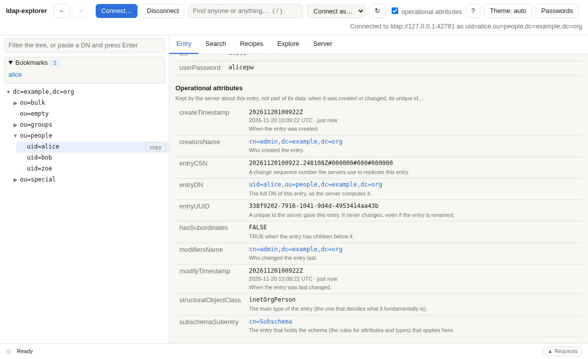

### Following links, Back and Forward

Many attributes point at other entries: `member` and `uniqueMember` in a group, `manager`, `owner`, `seeAlso`, `memberOf`, `secretary`... Their values are **links**: click one to open that entry, and the tree opens the branch that leads to it. The server's schema decides which attributes hold entries; when it is not available, the well-known ones are used and only values that really look like a DN become links (a description that happens to contain `a=b` never does).

**Back and Forward** work for the whole program, like in a browser. The **←** and **→** buttons are at the left of the top bar, always visible. The program remembers every **entry** you open and every **tab** you go to, so ← takes you back through them in reverse (an entry, the Search tab, another entry...), and → goes forward again. Hover a button to see where it leads. Opening something new after going back forgets what was "forward". The trail is cleared when you disconnect.

Other ways to do the same: the keys **`[`** and **`]`**, **Alt+←** and **Alt+→**, and the **back and forward buttons of your mouse**.

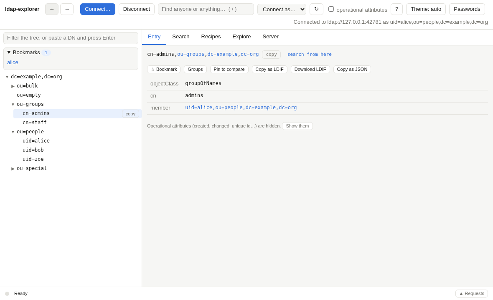

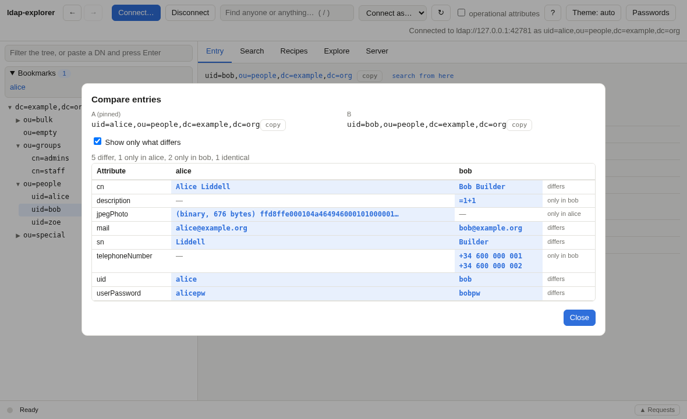

**Compare** shows the two entries field by field: values that differ are highlighted, fields found in only one entry are marked, and by default identical fields are hidden (untick *Show only what differs* to see everything).

## 6. Moving around

- **Big branches load page by page.** Opening a node reads only its first **200** children, not the whole branch, so a node with hundreds of thousands of entries opens at once. At the end of the list a row says *200 loaded, more below*: the next page loads **by itself as you scroll down to it**, or press **Load more** to get one more page, or **Load all** to keep going until the branch is complete (on a huge branch that can take a while; the status bar shows the progress and **Cancel** stops it). Within each page the entries are sorted by name; the pages follow the order the server gives. If the server has a size limit, the list stops there with a warning.

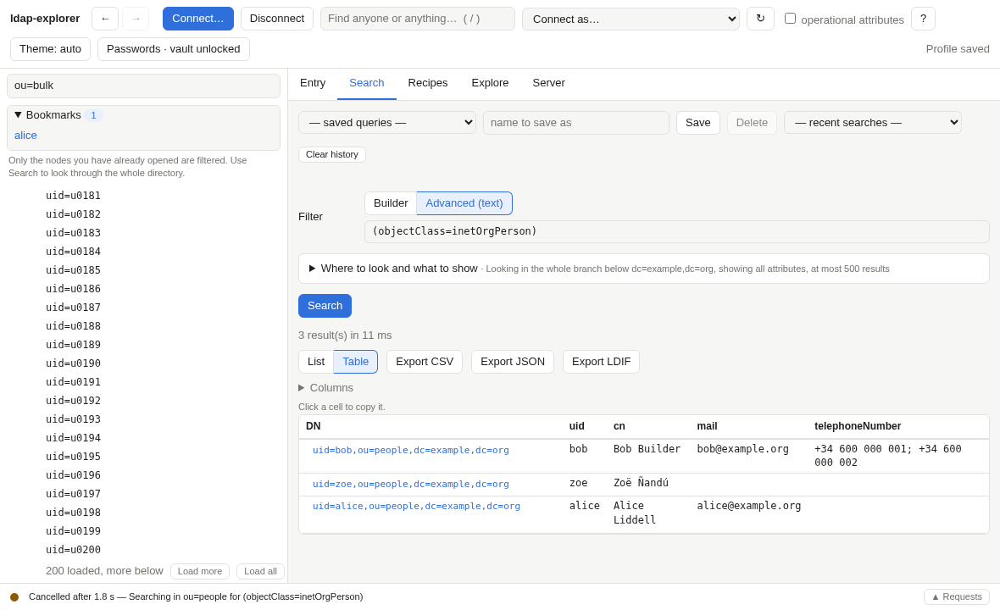

  *Go to a DN* (below) and links to entries also work inside big branches: the tree loads pages until it finds the entry. If the connection changes or the list stays open too long, the row says so and offers **Reload this branch**.
- **Filter the tree**: type in the box above the tree. Only the entries already loaded are searched (not the pages of a big branch you have not scrolled to, and not branches you have not opened; use Search for the whole directory, and the filter does not trigger loading more pages); the ancestors of a match stay visible. Escape clears it.
- **Go to a DN**: paste a DN in that box and press Enter, in any letter case; the tree opens the branches that lead to it.
- **Bookmarks**: click one to open the entry; **copy** copies its DN; **×** removes it.
- **Keyboard shortcuts** (they work when you are not typing in a box and no dialog is open; press `?` to see them in the program):

| Keys | What it does |
|---|---|
| `/` | Go to the search box |
| `t` | Filter the tree, or go to a DN |
| `g` then `e` / `s` / `r` / `x` / `v` | Go to Entry / Search / Recipes / Explore / Server |
| `g` then `b` | Open the bookmarks |
| `g` then `p` | Open the Passwords panel |
| `[` / `]`, `Alt+←` / `Alt+→`, mouse back / forward buttons | Back / forward through the entries and tabs you visited |
| `?` | Show the list of shortcuts |

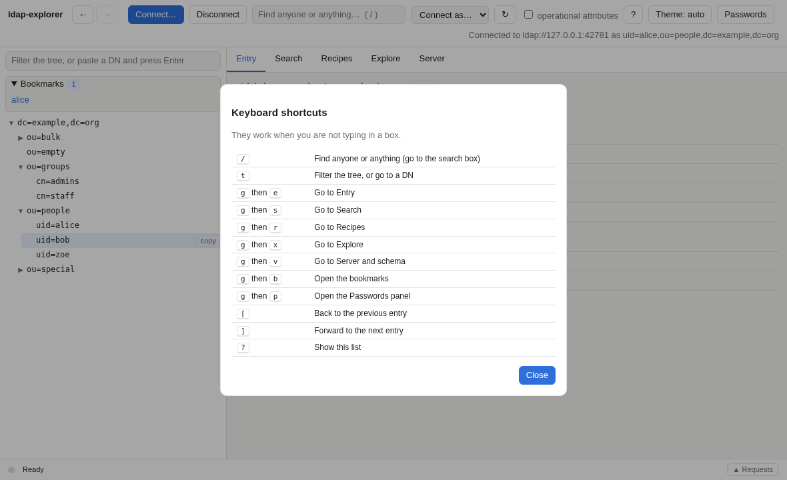

## 7. The server and its schema

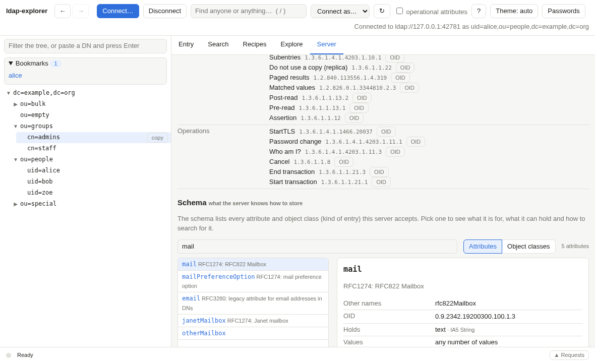

The **Server** tab has two parts.

**This server** says what kind of server it is (OpenLDAP, 389 Directory Server, Active Directory or unknown), its LDAP version, its **naming contexts** (the tops of its trees: click one to open it), and the *features* and *operations* it supports with readable names and copyable OIDs.

**Schema** is a browser of everything the server can store, in two lists you can filter by name, alias, OID or description:

- **Attributes**: what a field is for, what it holds (text, a number, a date, the DN of another entry, binary data), whether it takes one value or many, how it can be compared (equality, before/after, contains), whether it is an ordinary or operational attribute, which attribute it derives from, and **which object classes use it**.
- **Object classes** (kinds of entry): their kind (structural, auxiliary or abstract) with what that means, their parents up to `top`, and **the required and optional attributes including the inherited ones**.

Names in these views are links: follow them to move between attributes and classes. **Find entries that have it** and **Find entries of this kind** run a search.

## 8. Passwords, the vault and several users

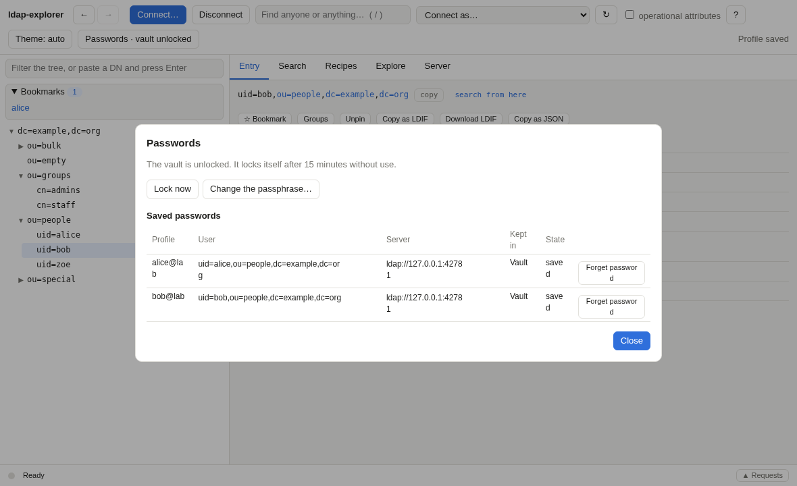

### Where a password can be kept

Each profile chooses, in **Password kept**:

| Choice | What it does |
|---|---|
| **Do not save** | The password is never stored. You type it each time. The safest, the least convenient. |
| **System keychain** | macOS Keychain, Windows Credential Manager or the Linux Secret Service. Protected by your operating system login. Not offered (and explained) on machines that have none, such as many Linux, WSL or headless setups. |
| **Encrypted vault** | A file protected by a **master passphrase** you choose, for machines without a keychain or if you prefer not to depend on it. |

Passwords are **never** written to `profiles.json` and the interface never receives one back: it only says whether one is saved. Leave the password field empty to use the saved one.

### The vault

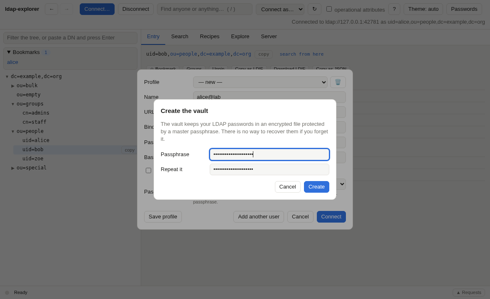

- The first time you save a password in it you are asked to create it (a passphrase of at least 8 characters). **There is no way to recover the passwords if you forget it**: delete the vault and enter them again.
- It starts **locked** and is unlocked by typing the passphrase when something needs it. It **locks itself after 15 minutes without use**; **Passwords → Lock now** locks it at once. The keys are wiped from memory when it locks.
- The file (`vault.json`) is encrypted with AES-256-GCM using a key derived from the passphrase with Argon2id (64 MiB, 3 passes). It does not even reveal *which* users or servers it holds, only how many entries there are. Tampering with the file is detected.
- Wrong passphrases are slowed down: after three failures each attempt has to wait longer (2 s, 4 s... up to a minute).
- **Passwords → Change the passphrase** re-encrypts everything under a new one.

### Several users, several servers

Each profile is one *user on one server*, with its own saved password, so you can keep as many as you need:

- **Connect as…** (top bar) lists your profiles as *name — user @ server*. Choosing one connects at once with its saved password, switching from whichever one you were using. If that profile keeps no password, the connection dialog opens ready for you to type it.
- **Add another user** (in the connection dialog) copies the server settings of the profile you are editing so you only enter the other user's name, DN and password. Use it for several accounts on one LDAP, for example your own and an administrator.
- The same user DN on two different servers (or on the same server over two URLs) are two different profiles with two different passwords.
- **Passwords** (top bar) shows, for every profile, where its password is kept and whether it is there (*saved*, *vault locked*, *not saved*...). **Forget password** removes it and stops saving it for that profile. Entries in the vault that no profile uses any more (for example after deleting a profile while the vault was locked) are listed so you can remove them.

When you change **where** a password is kept, it is **moved** (you do not retype it) and the old copy is removed. Changing the user of a profile, or deleting the profile, also removes the old password.

### Where things are stored

In your user configuration folder:

| | |
|---|---|
| macOS | `~/Library/Application Support/ldap-explorer/` |
| Windows | `%AppData%\ldap-explorer\` |
| Linux | `~/.config/ldap-explorer/` |

with `profiles.json` (server settings and which store each profile uses, never a password), `queries.json` (saved queries), and `vault.json` (the encrypted vault), all private to your user. The keychain keeps its entries under the service name `ldap-explorer`, account `<bind DN>@<URL>`.

### What this does not protect against

Be clear about the limits:

- Someone who can run programs as **your user** while the vault is unlocked, or while you are logged in for the keychain, can read what you can read. The vault protects the file at rest (a copy of it, a backup, a lost laptop), not a compromised session.
- The strength of the vault is the strength of your passphrase: a long one is far better than a short one if someone gets a copy of `vault.json`.
- The passphrase and the passwords pass through the memory of the program, and a managed runtime cannot guarantee wiping them: they may stay there until the memory is reused. The vault's keys are wiped on lock; strings are not.
- A saved password is used as it is to bind: ldap-explorer cannot make an LDAP server more secure than the connection to it, so prefer `ldaps://` or StartTLS and avoid *Skip certificate verification*.
- Entries saved by earlier versions in the macOS Keychain keep working, with one exception: a password containing non-ASCII characters saved by the old version could not be read back correctly then either. Save the profile password again to fix it.

## 9. Settings, command line and files

- **Theme** (top bar) cycles *auto* (follows your system), *light* and *dark*, and is remembered.
- Command line:

```
-port 0            local port (0 = random)
-no-open           do not open the browser automatically
-idle-exit 3m      exit if the tab has been closed for this long (0 = never)
-front-dir DIR     development: serve the interface from this folder (edit and refresh, no rebuild)
```

The 3-minute default of `-idle-exit` is deliberate: browsers throttle timers in background tabs, so a shorter value could make the program quit while the tab is still open.

Everything you create is kept in your user configuration folder (macOS `~/Library/Application Support/ldap-explorer/`, Windows `%AppData%\ldap-explorer\`, Linux `~/.config/ldap-explorer/`), private to your user:

| File | Holds |
|---|---|
| `profiles.json` | Server settings and which store each profile uses. Never a password. |
| `vault.json` | The encrypted vault. |
| `queries.json` | Saved queries. |
| `bookmarks.json` | Bookmarked entries. |
| `history.json` | Recent searches. |
| `settings.json` | The theme. |

## 10. Security model

- It listens only on `127.0.0.1`.
- Every start creates a random token placed in the URL `#` fragment (browsers never send fragments to servers). The API rejects requests without it, so other web pages cannot use the local server.
- It never modifies the directory: only bind and search operations are issued.
- Nothing is loaded from the internet by the interface (a strict Content-Security-Policy blocks it), and nothing is downloaded at run time.

## 11. What is supported

| Area | Status |
|---|---|
| Plain, `ldaps://` and StartTLS connections | Supported and tested (OpenLDAP). |
| Simple bind with DN + password; anonymous access | Supported. |
| Base DN auto-detection from the RootDSE | Supported. |
| Tree browsing with paging | Supported. |
| Entry view: attributes, UTF-8 values, links between entries, breadcrumb | Supported. |
| Back and Forward across entries and tabs (buttons, keys, mouse buttons) | Supported. |
| Operational attributes in their own section, each explained in plain words | Supported. |
| Photos drawn in place; download and base64 copy of binary values; dates in plain words | Supported. |
| Copying names, values, DNs, filters and table cells with one click | Supported. |
| Searching: the quick search box, the visual builder (one-click field chips, live filter and explanation), typed filters, scopes, attribute list, limit, paging, server size limits | Supported. |
| Builder options for fields whose comparison rules the server does not publish (Active Directory): guessed from the field's type, marked ⓘ | Supported, but only checked against OpenLDAP and synthetic schemas, not against a real Active Directory. |
| Recipes and the branch explorer | Supported. Recipes adapt to the server's schema; tested against OpenLDAP. |
| Saved queries and recent searches, per profile | Supported. |
| Results as a list or a sortable table; export to CSV, JSON and LDIF | Supported. |
| Entry actions: groups of an entry, bookmarks, pin and compare, copy or download as LDIF, copy as JSON | Supported. |
| Big branches in the tree: pages of 200 loaded on demand (scrolling, *Load more*, *Load all*) | Supported. Needs the server to support paged results (OpenLDAP, 389DS and Active Directory do); otherwise the whole branch is read at once. |
| A status bar with what is running, elapsed time, entries received so far, the usual time and Cancel | Supported. Progress by entries applies to paged searches (tree listings, searches, exports); other requests show their elapsed time. |
| Server information and a schema browser (attributes, object classes, inheritance, matching rules) | Supported. |
| Tree filter, go to a DN, bookmarks, keyboard shortcuts | Supported. |
| Saved profiles (no password) | Supported. |
| Passwords in the system keychain | macOS Keychain and Windows Credential Manager: supported and tested in CI. Linux (Secret Service): the library supports it but ldap-explorer is not tested against it. |
| Passwords in an encrypted vault with a master passphrase | Supported on every platform, tested. |
| Several saved users and servers, with one-click switching | Supported. |
| Light, dark or system theme | Supported. |

### Platforms

| Platform | Status |
|---|---|
| macOS arm64 | Supported. Built locally; the test suite, the Keychain tests and the `.app` build run in CI. |
| macOS amd64 | Cross-compiled in CI only; never run. |
| Windows amd64 | Supported. The test suite and the Credential Manager tests run in CI. No icon, and a console window stays open while it runs. |
| Linux | Builds and passes the test suite in CI; used mainly for development. Keychain not tested. |

### Servers

Tested against OpenLDAP 2.5, 2.6 and 2.7 only. The account recipes for 389 Directory Server (`nsAccountLock`, `passwordExpirationTime`) and for the OpenLDAP ppolicy overlay are checked against synthetic schemas, not against those real servers. Microsoft Active Directory and other servers should work for browsing and searching (the protocol operations are standard) but have **not** been tested. Known AD difference: no children hints, so every node shows ▶.

## 12. What is not supported

- **Any write operation**: add, modify, delete, rename, password change. This is intentional and checked by a test.
- **SASL, GSSAPI/Kerberos, NTLM and other bind mechanisms** (including single sign-on with your Windows or macOS login). Only simple bind is available.
- **Client certificates** (mutual TLS) and **custom CA bundles**: server certificates are checked against the system trust store, or not at all with *Skip certificate verification*.
- **Referrals** are not followed.
- **Several connections or sessions at once**; a second browser tab shares the same connection.
- **Importing** data, **ACL inspection**, and decoding of binary values other than showing photos (no GUID/SID or certificate formatting; the exact bytes are available through download, base64 and LDIF).
- **Server-side sorting, virtual list view and other LDAP controls.**
- **Proxy settings**: connections are direct.
- **Viewing a stored password**: by design there is no way to read one back; you can replace it (save the profile with a new password), move it or forget it.
- **Recovering a forgotten vault passphrase**, and **a configurable auto-lock time** (it is 15 minutes).
- **Client certificates, SASL or Kerberos** as saved credentials: only a bind DN and password can be stored.
- **Windows `.exe` packaging** (icon, no console window) and a signed or notarized macOS build. The macOS `.app` is ad-hoc signed and meant to be built on the machine that runs it.

## 13. Troubleshooting

| Symptom | Likely cause |
|---|---|
| `bind: LDAP Result Code 49 "Invalid Credentials"` | Wrong DN or password. On AD try `user@domain`. |
| `ldap: empty password not allowed by the client` | A Bind DN is set but the password is empty. Enter it, use the keychain option, or clear the Bind DN for an anonymous connection. |
| `no password in the keychain for this profile` / `...in the vault...` | The profile says its password is kept there but nothing is stored for that DN and URL. Type the password and save the profile again. |
| `the vault is locked` | Type the master passphrase when asked (or **Passwords → Unlock**). It locks itself after 15 minutes without use. |
| `wrong passphrase` / `too many failed attempts` | After three failures each try waits longer, up to a minute. |
| `the system keychain is not available here` | There is no usable keychain (no Secret Service on Linux, WSL, a headless session). Use the encrypted vault, or do not save the password. |
| `keychain: …` | The operating system keychain is unavailable (for example no Secret Service on Linux). |
| Certificate error on `ldaps://` or StartTLS | The server certificate is not trusted by the system. Install its CA in the system store, or (insecure) tick *Skip certificate verification*. |
| `No base was detected` | The server does not publish naming contexts to this user. Set **Base DN** in the connection. |
| `⚠ … Size Limit Exceeded` | The server stopped the listing or search at its own limit. Narrow the filter or base. |
| `Invalid filter` | The filter is not valid RFC 4515 syntax (check the parentheses). |
| The bar says *No answer from the server for…* | The directory has not sent anything for 30 seconds: it may be busy with a heavy search or the network is slow. Wait, or press **Cancel** and narrow the search (a more specific base or filter). |
| The bar says *Lost contact with ldap-explorer* | The program itself stopped. Start it again. |
| `The ldap-explorer process is not responding` | The program exited (idle timeout or Ctrl+C). Start it again. |
| `The vault is needed for this and was not unlocked.` | You closed the passphrase dialog. Try again and type the master passphrase. |
| Nothing happens when I press a shortcut | Shortcuts are off while you type in a box and while a dialog is open. Click on a blank part of the page first. |
| The photo does not appear | The value is not a picture the browser can draw. Use **download** or **base64** to get the exact bytes. |
| **Groups** says the server cannot say | The server's schema has no way to list members (`member`, `uniqueMember`, `memberUid`): the message gives the reason. |
| The schema list is empty | The server does not let your user read its schema. |

## 14. Glossary

| Word | In plain words |
|---|---|
| **Directory / LDAP** | A database of people, groups, computers... organised like a tree, and the protocol used to ask it questions. |
| **Entry** | One item in the directory: a person, a group, a unit. |
| **Attribute / field** | One piece of information of an entry: its email, its name, its phone. An attribute can have several values. |
| **DN** (distinguished name) | The full address of an entry, from the entry up to the top, for example `uid=alice,ou=people,dc=example,dc=org`. |
| **RDN** | The first part of a DN: how the entry is called among its siblings (`uid=alice`). |
| **Base** | Where a search starts. |
| **Scope** | How deep a search goes below the base: the whole branch, only direct children, or only the base itself. |
| **Filter** | The condition a search applies, for example `(mail=*@example.org)`. The builder writes it for you. |
| **Object class** | The kind of an entry (a person, a group...). It decides which attributes the entry must or may have. |
| **Schema** | The list of all the attributes and object classes the server knows. |
| **Operational attribute** | An attribute the server keeps for itself (when the entry was created, a unique id), not shown unless you ask. |
| **Bind** | Signing in to the directory with a DN and a password. |
| **Naming context / suffix** | The top of one tree held by the server. |
| **OID** | A numeric identifier (`2.5.4.3`) that names attributes, classes and server features without ambiguity. |
| **LDIF** | The standard text format for exporting entries so other tools can read them. |
