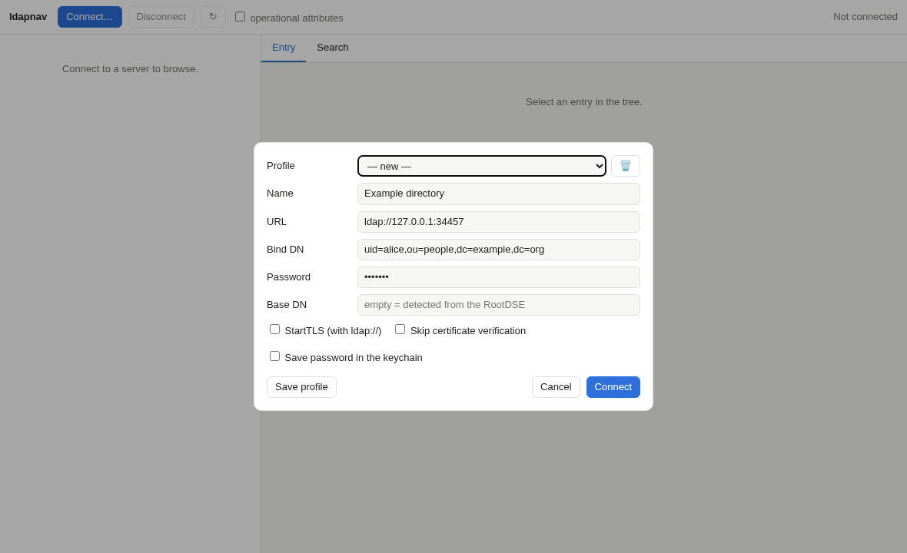

# ldapnav user manual

ldapnav is a read-only LDAP browser. It runs as a local program, serves its interface on `127.0.0.1` and opens it in your web browser. This manual explains how to use it and states plainly what it does and does not support.

## 1. Quick start

1. Build and start it (see the [README](../README.md#build)):
   ```sh
   make build && ./ldapnav        # macOS / Linux
   go build -o ldapnav.exe . && .\ldapnav.exe   # Windows
   ```
   Your browser opens on a local address such as `http://127.0.0.1:52341/#<token>`. If it does not, copy the URL printed in the terminal (start with `-no-open` to never open it automatically).
2. Click **Connect…**, fill in the server, and press **Connect**.
3. Browse the tree on the left; click an entry to see its attributes, or use the **Search** tab.
4. Close the browser tab when you are done: the program exits by itself a few minutes later (see `-idle-exit`). In a terminal you can also press Ctrl+C.

## 2. Connecting



| Field | Meaning |
|---|---|
| **Profile** | Pick a saved profile to fill the form, or `— new —`. The trash button deletes the selected profile. |
| **Name** | Name of the profile (required only to save it). |
| **URL** | `ldap://host[:port]` or `ldaps://host[:port]`. Default ports are 389 and 636. |
| **Bind DN** | The DN to authenticate as. For Active Directory a `user@domain` form also works. Empty means an anonymous connection. |
| **Password** | Required whenever a Bind DN is set (an empty password with a Bind DN is rejected by the client). |
| **Base DN** | Optional. Empty means it is detected from the server's RootDSE (`namingContexts`). If detection finds nothing, set it here. |
| **StartTLS** | Upgrade an `ldap://` connection to TLS. Ignored for `ldaps://`. |
| **Skip certificate verification** | Accept any server certificate. Insecure; use it only for lab servers with self-signed certificates. |
| **Save password in the keychain** | See section 5. |

**Save profile** stores the form (without the password) so you can reuse it. **Disconnect** closes the connection; **↻** reloads the tree.

There is one connection at a time. Connecting again replaces the previous one.

## 3. Browsing


- The tree starts at the detected (or configured) base DN(s). Click ▶ or double-click a node to expand it; click a node to see its entry.
- Servers that report whether an entry has children (OpenLDAP does, through `hasSubordinates`) get a ▶ only on nodes that have some. Servers that do not report it (Active Directory never does) make every node show ▶; expanding an empty node simply removes the arrow.
- Children are read in pages of 500, so servers that cap results per request still list everything the server allows. If the server's size limit cuts a listing, a `⚠` line appears at the end of that node with the server's message; what was received is still shown.
- The entry view lists attributes alphabetically with `objectClass` first. Multi-valued attributes show one value per line. **copy** copies the DN; **search from here** jumps to the Search tab with that DN as the base.
- Tick **operational attributes** to also show the server's operational attributes, such as `entryUUID` or `createTimestamp` on OpenLDAP.
- Binary values (for example `jpegPhoto`, `objectGUID`, `objectSid`) are shown as `(binary, N bytes)` followed by the first 16 bytes in hex. They cannot be downloaded, previewed or decoded.

## 4. Searching


Open the **Search** tab:

| Field | Meaning |
|---|---|
| **Base** | Where to start. Pre-filled with the first base DN after connecting. |
| **Filter** | An RFC 4515 filter, e.g. `(&(objectClass=person)(mail=*@example.org))`. Empty means `(objectClass=*)`. An invalid filter is rejected before it is sent. |
| **Attributes** | Comma- or space-separated names to return, e.g. `cn, mail, memberOf`. Empty returns all user attributes. Use `*` for all user attributes and `+` for all operational attributes, e.g. `* +`. |
| **Scope** | `subtree`, `one level` or `base only`. |
| **Limit** | Maximum number of entries (default 500). A value that is zero, empty or above 10000 falls back to 500. |

Press **Search** or Enter in any field. Results are collapsible; click **view** to open an entry in the Entry tab. A single result opens automatically.

### Results: list, table and CSV

Above the results there are two views, **List** and **Table**, and an **Export CSV** button. The chosen view is remembered for the next search.

- **List**: one collapsible block per entry with all its attributes.
- **Table**: one row per entry. The columns are the attributes you asked for, in your order; if you left the field empty (or used `*` / `+`), they are the attributes found in the results, most frequent first. Click a header to sort (natural order, so `u2` comes before `u10`; empty cells always go last) and click again to reverse. **Columns** lets you hide the ones you do not need. Click a DN to open the entry. The table draws at most 1000 rows; the CSV always has all of them.
- **Export CSV** saves exactly what the table shows now (visible columns, current order) plus a `dn` column. The file is UTF-8 with a byte order mark, so Excel opens accents correctly. Multiple values of one attribute are joined with `; `. Cells that start with `=`, `@`, `+` or `-` are prefixed with an apostrophe so spreadsheets do not run them as formulas (a directory is untrusted input); phone numbers such as `+34 600 000 001` are left as they are.


The interface follows the system light or dark setting:


Results are paged internally (up to 500 per request). If the server (or the limit you set) stops the search early, you get the entries received plus a `⚠` warning, such as `Size Limit Exceeded`, instead of an error.

## 5. Passwords and the keychain

- Passwords are **never** written to `profiles.json`.
- If you tick **Save password in the keychain** and save the profile, the password goes to the operating system keychain: service `ldapnav`, account `<bind DN>@<URL>`. Connecting with the password field empty then uses it.
- Profiles are stored in your user configuration directory:
  - macOS: `~/Library/Application Support/ldapnav/profiles.json`
  - Windows: `%AppData%\ldapnav\profiles.json`
  - Linux: `~/.config/ldapnav/profiles.json`
- The password field is not remembered between runs unless it is in the keychain.
- Entries saved by earlier versions in the macOS Keychain keep working, with one exception: a password containing non-ASCII characters saved by the old version could not be read back correctly then either. Save the profile password again to fix it.

## 6. Command-line options

```
-port 0            local port (0 = random)
-no-open           do not open the browser automatically
-idle-exit 3m      exit if the UI sends no heartbeat for this long (0 = never)
```

The 3-minute default is deliberate: browsers throttle timers in background tabs, so a shorter value could make the program quit while the tab is still open.

## 7. Security model

- It listens only on `127.0.0.1`.
- Every start creates a random token placed in the URL `#` fragment (browsers never send fragments to servers). The API rejects requests without it, so other web pages cannot use the local server.
- It never modifies the directory: only bind and search operations are issued.
- Nothing is loaded from the internet by the interface (a strict Content-Security-Policy blocks it), and nothing is downloaded at run time.

## 8. What is supported

| Area | Status |
|---|---|
| Plain, `ldaps://` and StartTLS connections | Supported and tested (OpenLDAP). |
| Simple bind with DN + password; anonymous access | Supported. |
| Base DN auto-detection from the RootDSE | Supported. |
| Tree browsing with paging | Supported. |
| Entry view, operational attributes, binary summary, UTF-8 values | Supported. |
| Searches: filter, scopes, attribute list, limit, paging, server size limits | Supported. |
| Saved profiles (no password) | Supported. |
| Passwords in the system keychain | macOS Keychain and Windows Credential Manager: supported and tested in CI. Linux (Secret Service): the library supports it but ldapnav is not tested against it. |
| Dark and light theme (follows the system) | Supported. |

### Platforms

| Platform | Status |
|---|---|
| macOS arm64 | Supported. Built locally; the test suite, the Keychain tests and the `.app` build run in CI. |
| macOS amd64 | Cross-compiled in CI only; never run. |
| Windows amd64 | Supported. The test suite and the Credential Manager tests run in CI. No icon, and a console window stays open while it runs. |
| Linux | Builds and passes the test suite in CI; used mainly for development. Keychain not tested. |

### Servers

Tested against OpenLDAP 2.5, 2.6 and 2.7 only. Microsoft Active Directory and other servers should work for browsing and searching (the protocol operations are standard) but have **not** been tested. Known AD difference: no children hints, so every node shows ▶.

## 9. What is not supported

- **Any write operation**: add, modify, delete, rename, password change. This is intentional and checked by a test.
- **SASL, GSSAPI/Kerberos, NTLM and other bind mechanisms** (including single sign-on with your Windows or macOS login). Only simple bind is available.
- **Client certificates** (mutual TLS) and **custom CA bundles**: server certificates are checked against the system trust store, or not at all with *Skip certificate verification*.
- **Referrals** are not followed.
- **Several connections or sessions at once**; a second browser tab shares the same connection.
- **LDIF or JSON export**, importing, saved searches or search history. (CSV export is supported.)
- **Schema browsing**, ACL inspection, and decoding of binary attributes (no image preview, no GUID/SID formatting).
- **Server-side sorting, virtual list view and other LDAP controls.**
- **Proxy settings**: connections are direct.
- **Changing or viewing a stored password** from inside the interface (delete and recreate the keychain entry, or save the profile again with a new password).
- **Windows `.exe` packaging** (icon, no console window) and a signed or notarized macOS build. The macOS `.app` is ad-hoc signed and meant to be built on the machine that runs it.

## 10. Troubleshooting

| Symptom | Likely cause |
|---|---|
| `bind: LDAP Result Code 49 "Invalid Credentials"` | Wrong DN or password. On AD try `user@domain`. |
| `ldap: empty password not allowed by the client` | A Bind DN is set but the password is empty. Enter it, use the keychain option, or clear the Bind DN for an anonymous connection. |
| `no password in the keychain for this profile` | **Save password in the keychain** is ticked but nothing is stored for that DN and URL. Type the password and save the profile. |
| `keychain: …` | The operating system keychain is unavailable (for example no Secret Service on Linux). |
| Certificate error on `ldaps://` or StartTLS | The server certificate is not trusted by the system. Install its CA in the system store, or (insecure) tick *Skip certificate verification*. |
| `No base was detected` | The server does not publish naming contexts to this user. Set **Base DN** in the connection. |
| `⚠ … Size Limit Exceeded` | The server stopped the listing or search at its own limit. Narrow the filter or base. |
| `Invalid filter` | The filter is not valid RFC 4515 syntax (check the parentheses). |
| `The ldapnav process is not responding` | The program exited (idle timeout or Ctrl+C). Start it again. |
